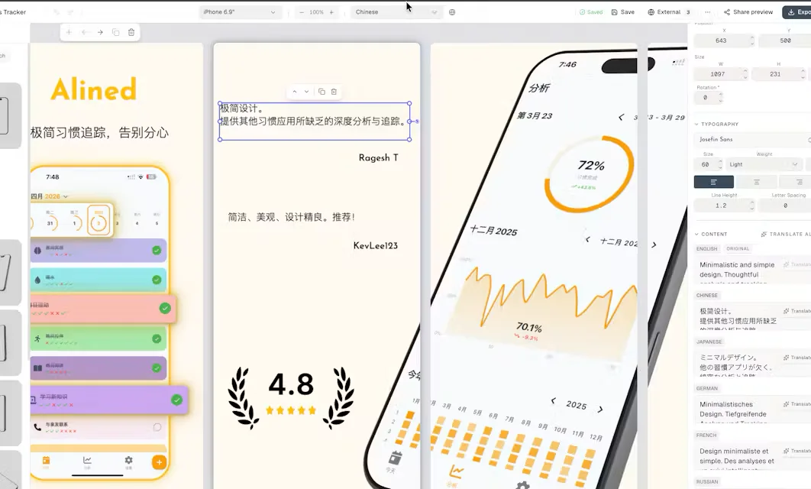
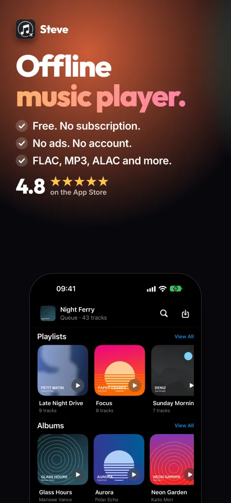
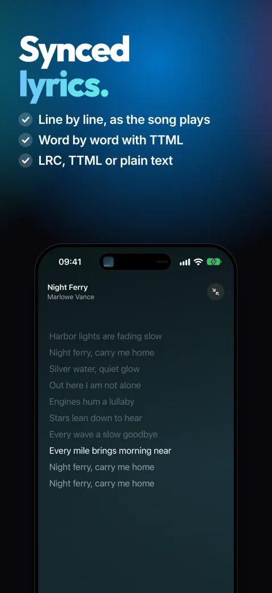
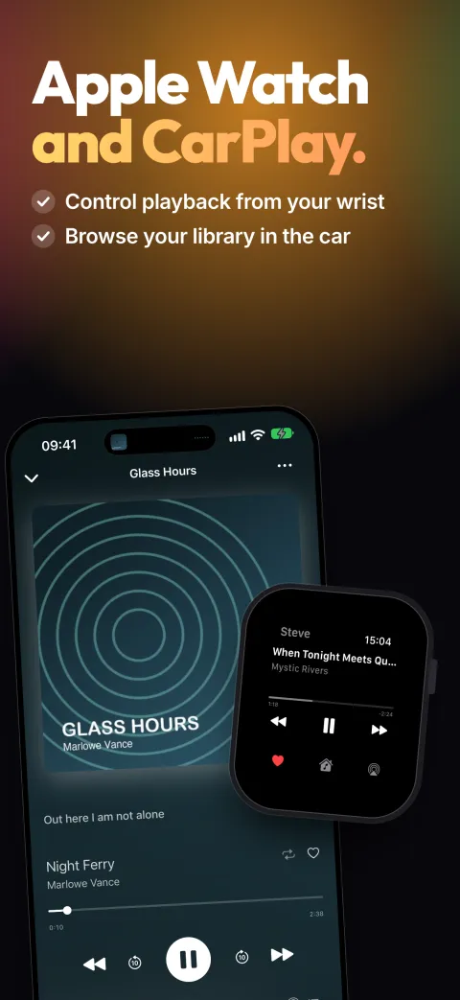

::: {.hero}
# Hamza Rabi {.title}

::: {.hero-lead}
Product engineer and founder. I design, build and run software products,
from the first line of code to the people paying for them.
:::

Since 2024 I've built and operated five products, my own ventures and
client work, across AI SaaS, consumer mobile, restaurant ordering and B2B
operations software. Before that I was a product data scientist at talabat
(Delivery Hero), working with five product squads across 8+ markets.
Based in Morocco.

[hamza-rabi@outlook.com](mailto:hamza-rabi@outlook.com) ·
[Resume (PDF)](assets/hamza-rabi-resume.pdf) ·
[LinkedIn](https://www.linkedin.com/in/hamza-rabi)

:::

::: {.stats}

::: {.stat}
[5]{.stat-n}

Products built and operated since 2024
:::

::: {.stat}
[20,000+]{.stat-n}

Organic installs for Steve, with ChatGPT as the top referrer
:::

::: {.stat}
[23,000]{.stat-n}

Monthly users at ilikeimg's peak, on a fully serverless stack
:::

::: {.stat}
[~30]{.stat-n}

Product experiments owned at talabat across 8+ markets
:::

:::

::: {.section-head}
[Work]{.section-label}
:::

::: {.project}

::: {.project-meta}
### BYC Study

[Live]{.pill .pill-live} [2026]{.when}

[Client · Django · PostgreSQL · Cloud Run · Kommo · Meta Conversions API]{.stack}
:::

::: {.project-body}
Operations platform for a study abroad and immigration consultancy,
replacing WhatsApp threads and spreadsheets. Prospects move from ad to
signed client in one system: lead qualification, e-signed contracts sealed
with an audit trail, document collection, and Canadian visa forms filled in
automatically from client answers.

CRM stages are streamed back to Meta's Conversions API, so ad campaigns
optimize for signed clients rather than form fills, and an automated triage
merges duplicate leads and routes them before an agent picks them up.
:::

:::

::: {.project}

::: {.project-meta}
### app-screenshots.com

[Sunset]{.pill}

[SaaS · Editor · AI localization]{.stack}
:::

::: {.project-body}
A studio for App Store screenshots: template library, iPhone, iPad and
Apple Watch mockups, and AI localization into every store language.

Taken from beta to paid plans, then discontinued: the market was saturated
and there was no acquisition channel that could scale.

{.wide}
:::

:::

::: {.project}

::: {.project-meta}
### Steve

[Live]{.pill .pill-live}

[iOS · watchOS · SwiftUI · 17 locales]{.stack}

[App Store ↗](https://apps.apple.com/us/app/steve-offline-music-player/id6751122850){.section-link}
:::

::: {.project-body}
An offline music player for people who own their library. **20,000+
installs, around 1,000 daily users and a 4.8 rating, with zero ad spend.**

It grew through a Reddit community built around user feedback and a public
roadmap. Those threads are now what ChatGPT cites for offline music players,
which makes it the app's top referrer.

::: {.shots}
{alt="Steve App Store screenshot: offline music player"}
{alt="Steve App Store screenshot: lyrics"}
{alt="Steve App Store screenshot: Apple Watch and CarPlay"}
:::
:::

:::

::: {.project}

::: {.project-meta}
### Sadeeq

[Wound down]{.pill}

[Abu Dhabi · Marketplace · Mobile + web]{.stack}
:::

::: {.project-body}
A commission-free alternative to delivery aggregators for restaurants that
run their own fleets: a merchant suite for ordering, live tracking, rider
dispatch and marketing, plus a consumer marketplace.

The concept took shape with feedback from Reddit users, and I sold it door
to door, **onboarding 3 restaurants and processing live orders**. After
seed conversations with two investors, I wound it down.
:::

:::

::: {.project}

::: {.project-meta}
### ilikeimg.com

[Retired]{.pill}

[SaaS · AWS Lambda · DynamoDB · SageMaker · Stripe]{.stack}
:::

::: {.project-body}
An AI image editing SaaS built on a freemium funnel: free in-browser tools
brought people in, paid AI features (merge, upscale, face swap) monetized
them. Serverless end to end on AWS, with Stripe billing and Google sign-in.

It scaled to **23,000 monthly users** before I retired it, once inference
costs outpaced revenue.
:::

:::

::: {.section-head}
[Before]{.section-label}
:::

::: {.before}
**Product Data Scientist, talabat (Delivery Hero), Dubai · 2022–2024.**
Embedded with five product squads, owning their experimentation across 8+
markets. Designed the quarterly holdout that isolated a 1.5% conversion lift
from a quarter of shipped features, halted a flawed Search launch, and built
the segmentation behind a discounts product that passed 15,000 daily orders
within six months.

**Freelance Data Analyst · 2020–2021.** Sourced and delivered my own
projects across marketing, finance and small business: NLP trend detection
on Twitter for a digital agency, backtested trading strategies for
investors, automated reporting for SMEs.

**Data Science Intern, VINCI Energies · 2020.** Built a building energy
forecasting pipeline end to end, benchmarking five model families before
delivering a deep learning model with uncertainty estimates.

**M.Eng., École Nationale Supérieure des Mines de Rabat.** Arabic, French
and English.
:::
