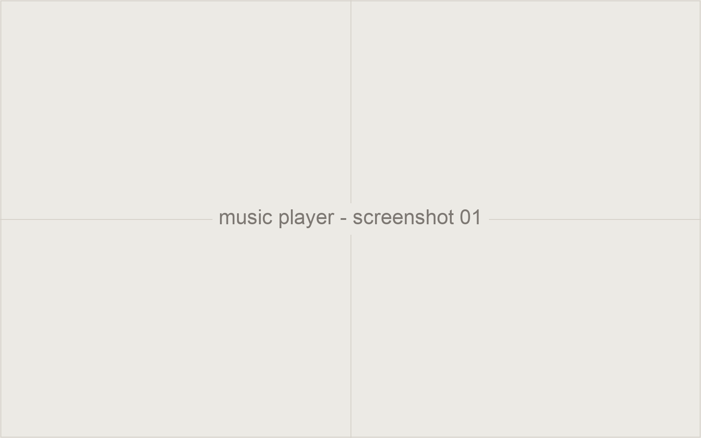
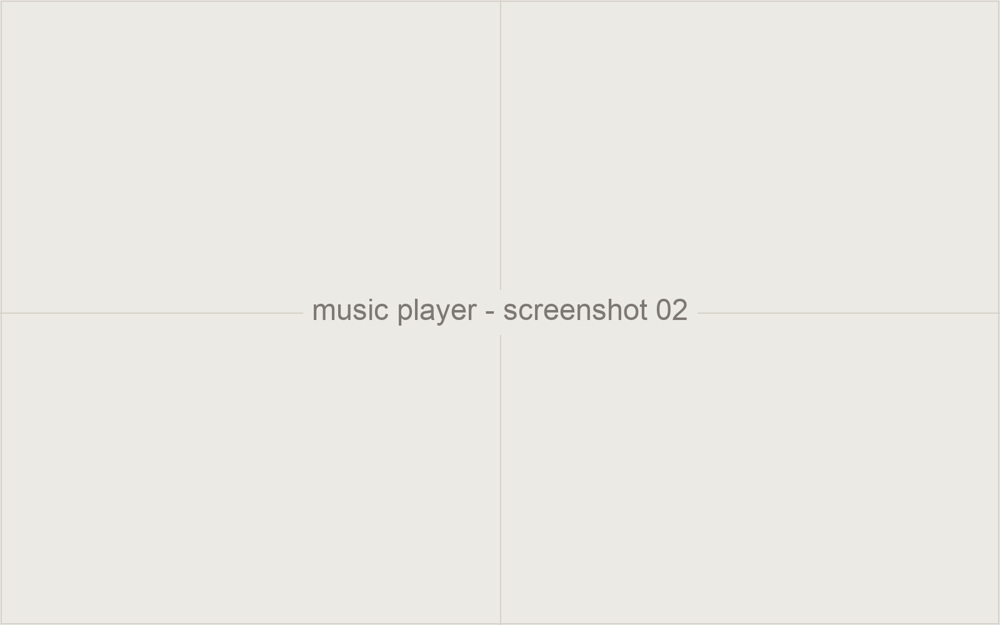

A privacy-first offline music player for iOS, built and still maintained. It
has grown organically to roughly 1,000 daily active users and a 4.8/5 App
Store rating, through community feedback and word of mouth, with no paid
acquisition.

## Instrumentation

Behavior is instrumented with PostHog and Google Analytics 4 to guide product
decisions: which flows people actually complete, where they drop, and which
requests in reviews correspond to real usage rather than loud minorities.

## Notes

Good place to write up a specific decision the analytics changed your mind
about. That's the part readers remember.
