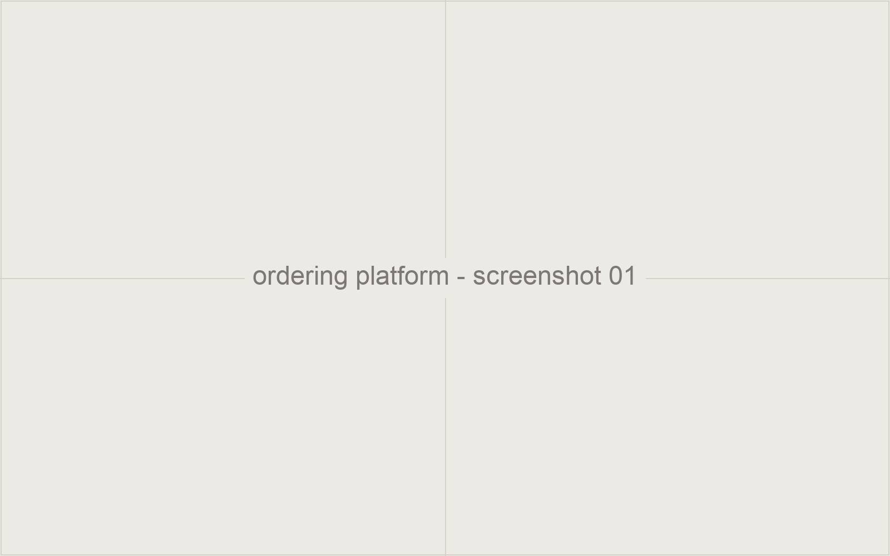

A commission-free ordering platform built as three applications, one each for
customer, merchant, and rider, aimed at restaurants that lose margin to
delivery marketplace fees.

Product-market fit was tested the slow way: customer discovery interviews and
onboarding local restaurant partners directly, rather than assuming the
commission-free pitch would sell itself.

## Notes

Worth covering: what the discovery interviews actually revealed, and how the
three apps share state.
